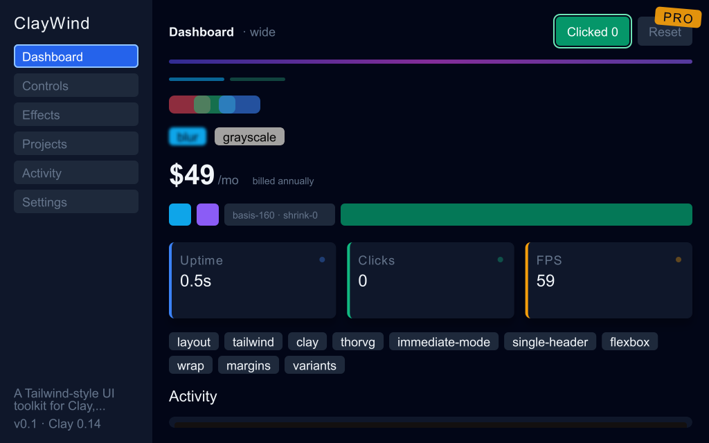
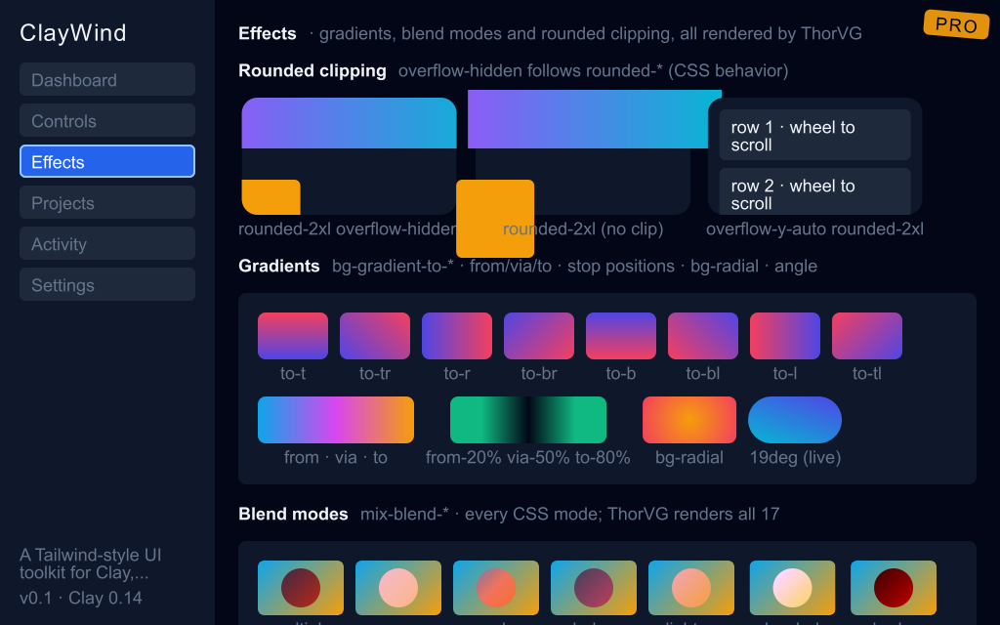

# Clay — ClayWind in pure CeeSafe

ClayWind is a Tailwind-flavoured immediate-mode UI toolkit: layout, rendering, text, controls and transitions. Its C
version is built on [Clay](https://github.com/nicbarker/clay), [ThorVG](https://github.com/thorvg/thorvg) and SDL3.
This repository is ClayWind ported to [CeeSafe](https://ceesafe.github.io/CeeSafe/), a memory-safe systems language
that compiles to C. It has **no C code and no dependencies**: no `extern "C"` in the port, and nothing to install but
the compiler.

The same demo runs in a native window on macOS, Windows and Linux, headless (for tests and screenshots), in a
browser, and in a terminal.





## What is in it

- **A layout engine.** A port of Clay 0.14's layout core, as ClayWind forked it: flex rows and columns, grow, fit,
  fixed and percent sizing, wrapping, gaps and margins, aspect ratios, floating and absolute elements, scrolling,
  line clamping, and per-element transforms. It is checked against the C original with a differential fuzzer.
- **A software renderer** that matches ThorVG's output: a render fuzzer against ThorVG finds 490 of 500 random
  frames identical, and every difference is a known, documented case.
  - Anti-aliased paths, rounded rectangles, borders and rings, linear and radial gradients, and images (PNG and BMP
    decoding included).
  - Shadows, blur, grayscale and brightness filters, opacity, and all CSS blend modes.
- **TrueType fonts:** glyphs read and rendered by the toolkit itself.
- **Retina output.** `Raster.setPixelRatio` draws at the display's pixel ratio while layout stays in points.
- **Incremental rendering.** `Damage` works out what changed between frames, and the raster redraws only those
  boxes. The result is byte-identical to a full redraw.
- **Controls:** buttons, checkboxes, text input with a caret, spin input, slider, radio, tabs, dropdown, single- and
  multi-select lists, context menu and tooltip.
- **Also:** focus cycling with Tab, vector icons, eased transitions, and dark and light themes.

## Repository layout

| Path | What it is |
|---|---|
| `claywind/` | The library: `layout_*`, `raster_*`, `font`, `image`, `controls`, `ui`, `style`, `transition`, `damage` and the rest, under `src/` |
| `claywind-demo/` | The demo app (the C version's `main.c`) and `ScriptPlatform`, a scripted input source for tests |
| `claywind-hosts/desktop/` | The demo in a native window: AppKit, Win32 or X11, through CeeSafe's `Window` |
| `claywind-hosts/headless/` | The demo rendered to files: screenshots, golden tests and benchmarks |
| `claywind-hosts/browser/` | An HTTP + WebSocket server streaming the demo to a `<canvas>` page |
| `claywind-hosts/terminal/` | A small dashboard drawn in a terminal, with mouse and keyboard |
| `claywind-tests/` | The test suite (`ceesafec test`) |
| `ClayWind-PORT-PLAN.md` | The port's plan and its results, phase by phase |
| `CEESAFE-FINDINGS.md` | What the port found in CeeSafe itself, and how each finding was resolved |

## Getting started

Install the CeeSafe compiler, **ceesafec 0.14.0 or later**:

```sh
curl -fsSL https://ceesafe.github.io/CeeSafe/install.sh | sh          # macOS and Linux
```

```powershell
irm https://ceesafe.github.io/CeeSafe/install.ps1 | iex               # Windows
```

`ceesafec` uses the system's C compiler: clang or gcc, or MSVC on Windows.

### The desktop app

```sh
cd claywind-hosts/desktop
ceesafec build
./out/desktop
```

- **Fonts.** It uses Arial, Arial Bold and Courier New. On Linux it uses the Microsoft core fonts, or falls back to
  DejaVu; `CLAYWIND_FONT_DIR=<dir>` points it elsewhere.
- **Light mode.** Press **T** to toggle it, or start the app with `CLAYWIND_LIGHT=1`.
- **The window** resizes freely. On a Retina display it draws one pixel per pixel.

### The other hosts

```sh
# Headless: write one frame (.bmp or raw RGBA)
cd claywind-hosts/headless && ceesafec build
CLAYWIND_SCREENSHOT=dashboard.bmp ./out/headless

# Browser: then open http://127.0.0.1:8080/
cd claywind-hosts/browser && ceesafec build && ./out/browser 8080

# Terminal: mouse, wheel and arrow keys; q quits
cd claywind-hosts/terminal && ceesafec build && ./out/terminal
```

The headless host also takes these, among others (see the top of its `src/main.cee`):

| Variable | What it does |
|---|---|
| `CLAYWIND_SCREENSHOT_TAB` | Which tab to show |
| `CLAYWIND_SHOT_EVENTS` | Scripted clicks and keys |
| `CLAYWIND_PIXEL_RATIO` | The pixel ratio to draw at |
| `CLAYWIND_INCREMENTAL` | Draw every frame through `Damage` |
| `CLAYWIND_BENCH` | Time the frames instead of writing one |

### Tests

```sh
cd claywind-tests
ceesafec test            # 72 tests; add --interp to run them in CeeSafe's interpreter
```

- **In this repository:** the test suite.
- **In the C ClayWind repository** (private, branch `ceesafe-port-tools`): the tools that compare the port with the
  C version.
  - **Layout:** a differential fuzzer against `clay.h`.
  - **Pixels:** a render fuzzer against ThorVG.
  - **The demo:** a scene-by-scene comparison.

## Using the library

ClayWind is immediate mode. Every frame:
1. the host gives `Ui.begin` a `Platform`, which supplies the input and the clock;
2. the app declares its elements and controls, styled Tailwind-fashion;
3. `endFrame` lays the frame out;
4. a `Backend` draws it. The built-in `Raster` is the software renderer; the host then shows its pixels.

The demo (`claywind-demo/src/demo.cee`) uses most of the API. `claywind-hosts/desktop/src/main.cee` is a complete
host loop in about 230 lines: window events, layout, incremental rendering, and presenting only the changed boxes.

## Status

- **Every host** builds and runs on macOS. The desktop host has also run on Windows 11 and on Ubuntu under X11.
- **The browser host** streams a fixed 1024 × 640 frame.
- **The terminal host** runs its own small dashboard. The full demo is laid out for pixels, not character cells.
- **Linux:** the desktop host needs X11; Wayland is not supported yet.
- **Not ported from the C version:** the debug view and Clay's built-in transitions. ClayWind has its own transition
  engine.

## Licence and credits

- **This port:** MIT ([LICENSE](LICENSE)); every source file is marked `SPDX-License-Identifier: MIT`.
- **Clay** (layout): the layout engine (`claywind/src/layout_*.cee`) is a port, altered for CeeSafe, of the ClayWind
  fork of [Clay](https://github.com/nicbarker/clay) 0.14, by Nic Barker. Clay is under the zlib/libpng licence:

  > Copyright (c) 2024 Nic Barker
  >
  > This software is provided 'as-is', without any express or implied warranty. In no event will the authors be
  > held liable for any damages arising from the use of this software.
  >
  > Permission is granted to anyone to use this software for any purpose, including commercial applications, and
  > to alter it and redistribute it freely, subject to the following restrictions:
  >
  > 1. The origin of this software must not be misrepresented; you must not claim that you wrote the original
  >    software. If you use this software in a product, an acknowledgment in the product documentation would be
  >    appreciated but is not required.
  > 2. Altered source versions must be plainly marked as such, and must not be misrepresented as being the
  >    original software.
  > 3. This notice may not be removed or altered from any source distribution.

- **ThorVG:** the renderer is written from scratch to match [ThorVG](https://github.com/thorvg/thorvg)'s output, and
  contains none of its code.
- **renderer.h:** ClayWind's Tailwind-style API began as
  [TomasBorquez/renderer.h](https://github.com/TomasBorquez/renderer.h).
